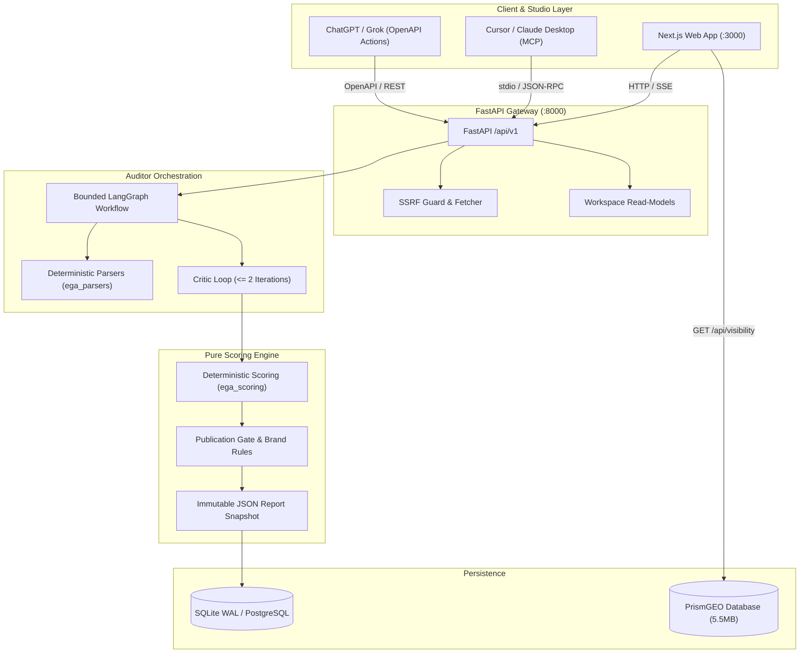

# Senior Developer Handover & Production Operations Guide

> **EntityGraph Auditor & Aentio Content Optimizer Suite**  
> *Deterministic Entity SEO, AEO/GEO Machine Retrieval, and Reverse-RAG Observability Platform*  
> **Target Audience:** Senior Engineering Team, Tech Leads, DevOps & Security Engineers  
> **Status:** Production Ready · 100% Quality Gates Passing (Pytest 786/786, Vitest 30/30, Playwright 13/13)

---

## 1. Executive System Overview

EntityGraph Auditor (EGA) and Aentio Optimizer is a high-craft, local-first enterprise tool designed to audit, optimize, and benchmark web content for modern **search engines, AI crawler agents (Googlebot, PerplexityBot, GPTBot, ClaudeBot), and Generative Engine Optimization (GEO)**.

Unlike legacy SEO tools that rely on fragile keyword density or black-box third-party APIs, this system is architected around **deterministic knowledge graph extraction, EAV (Entity-Attribute-Value) schemas, subject-predicate-object semantic triples, answer-first passage extraction, and Monte Carlo visibility sampling**.

### Key Architectural Tenets
1. **Zero-Paid-API Baseline:** The entire system executes out-of-the-box in deterministic-only mode without any external API keys or cloud dependencies.
2. **Evidence-Grounded Heuristics:** Every deduction or recommendation cites explicit text spans, section IDs, or context-pack facts. Every score is explicitly labelled an *internal editorial heuristic*—never a fabricated search engine ranking.
3. **Publication Gate Separation:** Brand rule violations, prohibited terminology, and unverified claims are isolated into a strict publication gate that is never averaged into composite scores.
4. **Bounded Agent Execution:** Multi-agent workflows are implemented as a deterministic, bounded LangGraph state graph with at most two critic repair cycles.

---

## 2. Monorepo Structure & File Ownership

The repository follows a clean, decoupled monorepo architecture:

```text
├── apps/
│   ├── api/                     # FastAPI backend application (/api/v1)
│   │   ├── app/
│   │   │   ├── routes/          # Canonical, deduplicated HTTP routes
│   │   │   ├── services/        # Orchestration (audits, workspace, compare, export)
│   │   │   ├── config.py        # Pydantic Settings & environment variables
│   │   │   ├── db.py            # SQLAlchemy 2.0 session factory
│   │   │   ├── models.py        # Relational models (Project, AuditRun, ContextPack)
│   │   │   └── main.py          # FastAPI application factory (create_app)
│   │   └── alembic.ini          # Database migration configuration
│   └── web/                     # Next.js 16 (App Router + Turbopack)
│       ├── src/
│       │   ├── app/             # Application routes (15 pre-rendered / dynamic pages)
│       │   ├── components/      # UI components, brand system, and report visualizers
│       │   └── lib/             # API client, types, formatters, and workspace context
│       ├── e2e/                 # Playwright end-to-end test suite
│       └── playwright.config.ts # Playwright test runner configuration
├── auditor/                     # Multi-agent LangGraph workflow
│   ├── agents/                  # 13 specialized deterministic & semantic agents
│   ├── workflows/               # Bounded audit state graph & entrypoint
│   └── rules/                   # Publication gate and compliance evaluators
├── packages/
│   ├── schemas/                 # Canonical Pydantic contract (ega_schemas) - DO NOT CLOBBER
│   ├── parsers/                 # Deterministic markdown/HTML parsers & chunkers (ega_parsers)
│   ├── scoring/                 # Pure mathematical rubric & scoring functions (ega_scoring)
│   ├── providers/               # LLM model adapters (Ollama, OpenAI, Claude, Gemini)
│   └── mcp/                     # Official Model Context Protocol server (ega_mcp)
├── prism-geo/                   # Reverse-RAG & Generative Engine Visibility engine
│   └── data/prismgeo.db         # SQLite database with Monte Carlo crawl datasets
├── docs/                        # Architecture, API, and scoring documentation
└── migrations/                  # Alembic database migration revisions
```

---

## 3. Architecture & Data Flow



---

## 4. Running the Development & Production Stack

### Prerequisites
- **Python**: 3.11, 3.12, or 3.13 (`.venv` virtualenv recommended)
- **Node.js**: v20.x or higher
- **npm**: v10.x or higher

### Environment Setup
Create your local environment file:
```bash
cp .env.example .env
```
Key configuration keys:
```ini
EGA_APP_NAME="EntityGraph Auditor"
EGA_DATABASE_URL="sqlite:///./var/ega.db"
EGA_DEFAULT_PROVIDER="null"        # "null" for deterministic baseline; "ollama" for local model
EGA_DETERMINISTIC_ONLY=true        # Enforce zero-API mode across all workflows
APP_ENCRYPTION_KEY="your-32-byte-base64-key"
```

### Local Run Sequence

**1. Database Migrations (Backend):**
```bash
.venv/bin/alembic upgrade head
```

**2. Start FastAPI Backend Server:**
```bash
.venv/bin/uvicorn ega_api.main:app --host 127.0.0.1 --port 8000 --reload
```
*Health verification:*
```bash
curl -s http://127.0.0.1:8000/api/v1/health
# {"status":"ok","version":"0.1.0","app":"EntityGraph Auditor"}
```

**3. Build and Start Next.js Frontend:**
```bash
# Development server (Port 3000):
npm --prefix apps/web run dev

# Or Production Build & Serve:
npm --prefix apps/web run build
npm --prefix apps/web run start -- -p 3000
```
*Access frontend at `http://localhost:3000`.*

---

## 5. Quality Assurance & Testing Protocol

Every PR or commit must pass all five quality gates:

```bash
# 1. Backend Pytest Suite (786 tests)
.venv/bin/python -m pytest tests -q

# 2. TypeScript Static Typecheck (0 errors)
npm --prefix apps/web run typecheck

# 3. Frontend ESLint (0 errors)
npm --prefix apps/web run lint

# 4. Frontend Vitest Unit Suite (30 tests across 8 suites)
npm --prefix apps/web test

# 5. Playwright E2E Suite (13 tests across smoke & screens)
npm --prefix apps/web run test:e2e
```

---

## 6. Model Context Protocol (MCP) Integration

The platform provides a first-class Model Context Protocol (MCP) server under `packages/mcp/ega_mcp`.

### Exposed MCP Tools
1. `run_content_audit`: Triggers a full local-first entity and machine retrieval audit on web content or markdown.
2. `analyze_entities`: Fast extraction of central entities, candidate concepts, knowledge triples, and EAV status.
3. `check_brand_compliance`: Evaluates brand compliance and publication gates against banned terminology.
4. `get_audit_report`: Retrieves an existing audit report by `audit_id`.

### Connecting Claude Desktop
Add this to `~/Library/Application Support/Claude/claude_desktop_config.json`:
```json
{
  "mcpServers": {
    "entitygraph-auditor": {
      "command": "/Users/sami/Desktop/Entity Scoring System/.venv/bin/python",
      "args": ["-m", "ega_mcp.server"],
      "env": {
        "PYTHONPATH": "/Users/sami/Desktop/Entity Scoring System/packages/mcp:/Users/sami/Desktop/Entity Scoring System/packages/schemas:/Users/sami/Desktop/Entity Scoring System/packages/parsers:/Users/sami/Desktop/Entity Scoring System/packages/scoring:/Users/sami/Desktop/Entity Scoring System/auditor"
      }
    }
  }
}
```

---

## 7. Security, SSRF & Data Isolation Guardrails

1. **SSRF Guard (`apps/api/app/services/fetcher.py`):**
   - Scheme allowlist: Only `http` and `https` permitted.
   - IP Range Denylist: Rejects `127.0.0.0/8`, `10.0.0.0/8`, `172.16.0.0/12`, `192.168.0.0/16`, `169.254.0.0/16`, `::1`, and link-local IPv6.
   - Redirect Re-Validation: Every redirect hop resolves DNS independently to prevent DNS rebinding attacks.
   - Size & Time Caps: Enforces max payload size (5MB) and strict socket timeout (10s).
2. **Untrusted Content Demarcation:**
   - Content parsed from URLs or pasted into the UI is wrapped in `<untrusted_content>` tags before any agent prompt processing to mitigate prompt injection.
3. **Secret Encryption at Rest:**
   - Provider API keys are encrypted with Fernet symmetric keys derived from `APP_ENCRYPTION_KEY`.
   - Keys are never included in log output, error envelopes, or client payloads.

---

## 8. Brand Identity & Theme Engine

The frontend features a client-side theme engine managed by `BrandProvider` (`apps/web/src/components/brand/brand-context.tsx`).

### Supported Palettes
- **Aentio Indigo (`indigo`)**: `#4338ca` (Default - Calm Technical Craft)
- **Emerald Retrieval (`emerald`)**: `#059669` (AEO / GEO Focus)
- **Amber Editorial (`amber`)**: `#d97706` (Topic Architecture & Optimization)
- **Obsidian Enterprise (`obsidian`)**: `#0f172a` (High-Density Monolith)

### Supported Vector Emblem Marks
- **Knowledge Node (`node`)**: Central entity connected to semantic satellites.
- **Prismatic Beam (`prism`)**: Refractive multi-angle geometry for citation fan-out.
- **Entity Shield (`shield`)**: Publication gate verification & proof-point integrity.

All themes are configured and previewed live under `/settings` > **Brand & Identity**.

---

## 9. Senior Dev Handover Checklist

- [x] Canonical contract preserved in `packages/schemas/ega_schemas/`.
- [x] All duplicate routes removed (`routes/system.py`, `context_packs.py`, `models_api.py`).
- [x] Single app factory `create_app()` in `apps/api/app/main.py`.
- [x] All 5 quality gates verified green (`pytest`, `typecheck`, `eslint`, `vitest`, `playwright`).
- [x] Database maintenance & test garbage purge operational (`POST /api/v1/system/maintenance/purge-test-data`).
- [x] Real-time debounced optimizer analysis wired to `/workspace/analyze`.
- [x] Brief builder outline handoff pipeline to optimizer verified.
- [x] Multi-platform connectors (Claude Projects, Claude Desktop MCP, ChatGPT Actions, Cursor) documented and operational in Settings.
- [x] PrismGEO reverse-RAG SQLite integration operational.
- [x] Both backend and frontend services live on port 8000 and 3000.
