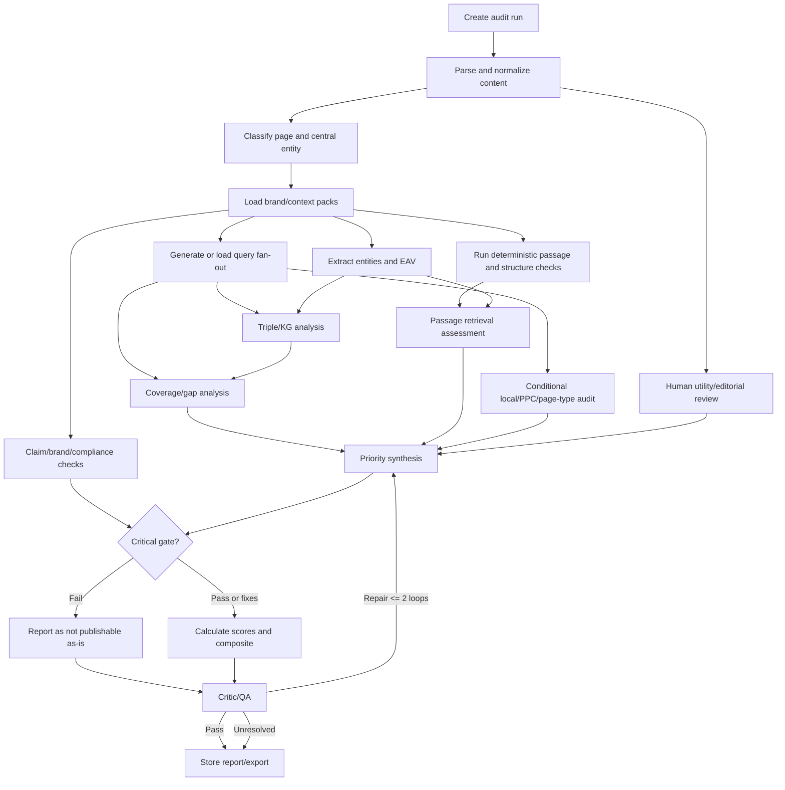

# Product Requirements Document (PRD)
# Entity, AEO, GEO & AI Retrieval Content Auditor

**Product codename:** EntityGraph Auditor  
**Document version:** 1.0  
**Prepared:** 2026-10-16  
**Status:** Build-ready product specification; implementation details must be checked against current dependency releases before coding  
**Primary audience:** AI coding agent, technical lead, product owner, QA/evaluation agent  
**License target:** Apache-2.0 (recommended; confirm third-party dependency compatibility)  
**Deployment target:** Self-hosted, local-first, Docker Compose  
**Core requirement:** Free and open-source software that can run with local models and does not require a paid API to execute a baseline audit.

---

## 0. Instructions to the AI Coding Agent

Treat this PRD as the source of truth for the first implementation. Build a usable, testable product—not a mock dashboard or a pile of disconnected agents.

### Non-negotiable engineering rules

1. **Build a working vertical slice first.** A user must be able to paste content, select a page type, run an audit with a local or configured model, inspect evidence-backed findings, and export the report before advanced integrations are started.
2. **Use deterministic analysis wherever possible.** Parsing, heading inventory, link extraction, text statistics, repeated-phrase detection, missing metadata detection, simple claim patterns, and score arithmetic must be implemented as ordinary code. Use LLMs for semantic judgments that code cannot reliably make.
3. **Use bounded agents, not an uncontrolled agent swarm.** The workflow must be a predictable graph with typed inputs and outputs, timeouts, token limits, retries, trace IDs, cached intermediate results, and a final critic/validation step.
4. **No hallucinated evidence.** Every finding must point to a text span, a missing expected item, a verified external source, or a clearly labelled analytical inference. Never fabricate entities, credentials, URLs, citations, integrations, certifications, metrics, or customer outcomes.
5. **Every score is a heuristic.** Label all scores “internal editorial heuristic—not an official Google, Bing, OpenAI, Anthropic, or Perplexity metric.” Never claim to predict rankings or guarantee AI citations.
6. **No paid provider is mandatory.** A complete local mode must use self-hosted models and local storage. Cloud model APIs are optional bring-your-own-key (BYOK) connections and may incur provider fees.
7. **MCP is a tool/context protocol, not a model API.** Build separate provider adapters for LLMs and a Model Context Protocol (MCP) server/client layer for tool interoperability.
8. **Do not depend on undocumented platform internals.** Separate vendor-documented facts, third-party measurements, practitioner observations, and hypotheses in the UI and reports.
9. **Do not optimize by stuffing terms.** Recommendations must improve user intent satisfaction, meaningful entity coverage, explicit relationships, evidence, and readability—not raw entity counts.
10. **Do not alter/publish content automatically without explicit user approval.** The app is an auditor and writing copilot, not an autonomous CMS publisher by default.
11. **Treat uploaded pages and fetched websites as untrusted data.** Content may contain prompt injection. It must never override system instructions, expose secrets, or authorize tool execution.
12. **Document assumptions and limitations.** If the source text cannot prove a fact, label it “verify” or “not assessed,” rather than guessing.

### Required work sequence

- Phase A: inspect requirements, write architecture notes, create repo, lock dependencies and licenses.
- Phase B: implement schemas, deterministic text parser, basic scoring engine, database, and export.
- Phase C: implement model provider adapters and one full multi-agent audit workflow.
- Phase D: build usable frontend and report workspace.
- Phase E: add MCP server, URL fetching, context packs, and quality evaluation harness.
- Phase F: harden, document, test, and verify full offline/local operation.

Do not skip tests to make the interface appear complete. Keep a `DECISIONS.md`, `SECURITY.md`, `THREAT_MODEL.md`, `EVALUATION.md`, and `CHANGELOG.md` current.

---

## 1. Executive Summary

EntityGraph Auditor is a free, open-source, self-hostable content auditing platform for entity SEO, semantic SEO, local SEO, Answer Engine Optimization (AEO), Generative Engine Optimization (GEO), and AI-search retrieval readiness.

It analyzes web pages, draft copy, landing pages, articles, and site-level content context. It identifies central and supporting entities, entity attributes and values, explicit/inferred/missing semantic triples, intent coverage, query fan-out gaps, passage-level extractability, proof and source gaps, brand/claim conflicts, geographic dilution, internal-link opportunities, and human-readability issues. It produces transparent heuristic scores, a SWOT analysis, and prioritized writer/developer handoffs.

The software combines:

- deterministic parsers and scoring calculations;
- multilingual entity and concept extraction;
- provider-agnostic LLM agents for semantic interpretation;
- configurable brand books, topical maps, canonical entity facts, skills, and claim rules;
- optional web/source research and connected analytics data;
- explicit evidence provenance and uncertainty labels;
- multi-agent orchestration through a constrained workflow graph;
- a provider-neutral MCP interface for other assistants and agent environments.

### Core product promise

**Turn any piece of content into an auditable map of intent, entities, attributes, relationships, evidence, passages, gaps, and actionable changes—without pretending an opaque score is a search-engine metric.**

### What “maximum score” means

The objective is not to inflate scores. The objective is to increase accuracy, usefulness, coverage of relevant intent, explicitness of important relationships, evidence quality, retrieval-ready phrasing, and readability. Scores must decline when content adds irrelevant entities, makes unsupported claims, dilutes the target location, or creates repetitive text for the sake of AI systems.

---

## 2. Product Vision, Goals, and Non-Goals

### 2.1 Vision

Provide a transparent, repeatable and extendable open-source alternative to opaque AI-content “scores,” tailored to agency, SEO, content strategy, and technical marketing workflows.

### 2.2 Goals

1. Audits are repeatable and explainable.
2. Every meaningful recommendation states **what, where, why, how, and what to verify**.
3. Users can compare draft versions and see which evidence-backed dimensions improved or regressed.
4. Users can operate fully locally or choose an external model provider.
5. Users can import custom skills and context packs instead of being locked into one brand or methodology.
6. The audit workflow can run as a single service or expose compatible tools through MCP.
7. Results respect page type: a service page, glossary, local page, About page, comparison, and paid landing page should not be judged by the same unmodified rubric.
8. Results include limitations, confidence, provenance, and a validation plan.
9. The product supports English, French, and Bengali at launch, with language-specific capabilities and confidence disclosed where local NLP support is weaker.
10. It remains useful even when optional web search, cloud APIs, embeddings, or advanced NER models are unavailable.

### 2.3 Non-goals

- Guaranteeing rankings, traffic, inclusion in AI answers, or citations.
- Claiming access to private Google/Bing/OpenAI ranking or reranking metrics.
- Replacing SEO technical crawlers, legal counsel, vets, clinicians, engineers, or other domain experts.
- Automatically creating a separate page for every fan-out query.
- Maximizing entity density regardless of intent.
- Scraping restricted websites, bypassing access controls, or ignoring robots policies.
- Requiring a proprietary model, a paid SaaS account, or a hosted proprietary database.
- Training or fine-tuning foundation models as part of the MVP. The tool uses prompts, schemas, local heuristics and optional models; it does not claim to “train an LLM.”
- Automatically publishing edits to a CMS in the first release.

---

## 3. Target Users and Jobs-to-be-Done

### Persona A — SEO / Semantic SEO Strategist

**Needs:** entity coverage, EAV gaps, semantic triples, topical completeness, internal links, search intent mapping, content briefs, version comparisons.  
**Success:** receives concrete changes tied to relevant queries and score components rather than a generic “add keywords” list.

### Persona B — Content Lead / Editor

**Needs:** brief, writer handoff, section rewrites, readability review, claim sources, consistency checking, approval gate.  
**Success:** editor can assign high-priority fixes to a writer without translating an abstract audit into tasks.

### Persona C — Local SEO / Agency Specialist

**Needs:** service-area clarity, local entity authenticity, neighbourhood/landmark fit, proximity language, location dilution detection, multi-city content comparison.  
**Success:** page stays focused on its actual target city or service region without fabricated “local flavor.”

### Persona D — AEO/GEO Researcher

**Needs:** sub-query fan-out, passage audit, citation-worthiness, AI-platform observation logs, evidence-based hypotheses, prompt tracking.  
**Success:** can distinguish direct platform evidence from modeled queries and subjective editorial judgments.

### Persona E — PPC / Conversion Strategist

**Needs:** keyword-to-page intent fit, ad-group alignment, offer clarity, landing-page clarity, keyword clusters that do not match the copy.  
**Success:** can separate content mismatch from bid, auction, ad relevance, or conversion-tracking issues.

### Persona F — Brand / Compliance Owner

**Needs:** canonical brand facts, approved statistics, banned claims, integration status, proof rules, legal-risk flags.  
**Success:** a high numeric score cannot conceal a critical claim or brand-policy failure.

### Persona G — AI Coding Agent / MCP Client

**Needs:** structured reports, tool-callable audits, context retrieval, stable input/output schemas.  
**Success:** can invoke a repeatable audit, retrieve a report, and make recommendations without using the UI.

---

## 4. Product Principles

1. **Evidence before assertion.** A finding must cite a span, rule, data point, or external source.
2. **Central entity before term list.** Identify what the page is about, why it exists, and what it is expected to help a person do.
3. **Attributes need values.** “Fast,” “flexible,” and “high quality” are not useful without an actual timeframe, method, qualification, or proof.
4. **Relationships matter more than raw mentions.** Model entity → predicate → entity/value relationships.
5. **Intent determines relevance.** The page type and query shape determine which entities matter.
6. **Passage clarity, not artificial chunking.** Make sections locally understandable and answer-first for people and retrieval systems; do not recommend fragmenting content into tiny blocks just for AI.
7. **Information gain is a first-class metric.** Distinguish original evidence and operational knowledge from commodity restatement.
8. **Human usefulness is not negotiable.** Every suggested addition must help the reader, answer intent, substantiate a claim, or support a meaningful next action.
9. **One number cannot summarize all risk.** Scores are shown separately and critical compliance/accuracy gates are never averaged away.
10. **Observed and simulated data are different.** Query fan-out generated by the app must be labelled simulated unless grounded in Search Console, Bing Webmaster Tools, actual SERP research, or another recorded source.

---

## 5. Page-Type System

User-selected page type always overrides the classifier's suggestion. The classifier provides a type, confidence, and rationale.

Required page types:

1. Homepage / Entity home
2. About / Team / Company story
3. Commercial service page
4. Location-specific service page
5. Informational article / tutorial
6. Glossary / definition
7. Listicle / “best X” page
8. Comparison / alternative / versus
9. Case study / customer story
10. B2B / SaaS commercial page
11. Integration / platform page
12. Paid-search landing page
13. Product/category page
14. Trust, certification, policy, or compliance page
15. Technical documentation
16. General / custom page type

Each type defines:
- expected central entity;
- likely intent classes;
- answer shapes;
- expected proof types;
- required attributes/values;
- conversion goal;
- relevancy penalties;
- composite score weights;
- local/geographic relevance applicability;
- common failure patterns.

Examples:

- **Glossary:** reward an early 40–60-word definition containing category and distinguishing function; then attributes, variants, examples and links.
- **Comparison:** apply identical criteria to every compared option; require use-case verdicts and disclose limitations.
- **Local service page:** reward one dominant geographic entity, real local relevance, consistent service-area signals and conversion clarity; penalize unnecessary city mixing.
- **Homepage:** reward central brand/category clarity, coherent service architecture and links to appropriate detail pages; penalize attempts to exhaust every service topic on the homepage.
- **Paid landing page:** emphasize search-term/ad-group match, message continuity, offer clarity, trust, form friction and conversion alignment; do not confuse this score with actual Google Ads Quality Score.
- **Case study:** prioritize verified evidence, baseline, intervention, timeframe, measured result, method and attribution.

---

## 6. End-to-End User Workflow

### 6.1 Create project

Fields:
- project name;
- brand/company;
- website/base URL (optional);
- language(s);
- country/region and target market;
- industry;
- target audience/ICP;
- central entity or product category;
- target conversion;
- preferred model profile;
- context pack selection;
- source and data connectors.

### 6.2 Add content

Supported input sources:
- Paste text/Markdown/HTML;
- upload `.md`, `.txt`, `.html`, `.docx`, `.pdf` (optional extraction service), `.csv`, `.json` and `.yaml` context files;
- enter URL for permitted HTTP retrieval;
- import sitemap XML;
- import a list of URLs;
- import a topical map/content brief CSV/XLSX;
- import a skill pack archive containing Markdown/JSON/YAML files;
- duplicate a previous audit and provide updated content.

For URL fetches, store fetched time, HTTP status, canonical URL if present, parser used, render mode, and retrieval limitations. Never pretend a text-only audit has validated crawlability, indexing, JavaScript rendering, schema validity or bot access.

### 6.3 Configure audit

Required/optional fields:
- page type (suggested if absent);
- primary query/topic;
- secondary query cluster;
- audience/ICP;
- location target (optional, required for location-fit scoring);
- conversion goal;
- page URL (if live);
- competitors or sources (optional);
- current/published vs draft;
- target platform(s) to monitor;
- sensitivity tier (ordinary / high-stakes / regulated);
- source profile: offline, local web search, user-supplied sources, connected data;
- brand rule pack and scoring profile;
- desired audit depth (quick / standard / deep).

Missing inputs must not block the audit unnecessarily. The application lists assumptions and lowers confidence where appropriate.

### 6.4 Run audit

Show a staged progress timeline, agent status, retries, skipped stages, source retrieval status, and whether each result is deterministic, model-generated, or externally verified. Never show a fake percentage of completion if the execution system cannot calculate it.

### 6.5 Review report

Main views:
- executive summary;
- scorecard and component explanations;
- central entity and entity inventory;
- EAV matrix;
- semantic triple/relationship graph;
- query fan-out and coverage matrix;
- passage-level findings;
- claim/evidence ledger;
- local/paid/brand-specific findings;
- recommendations ranked by priority;
- writer handoff;
- SWOT;
- source citations and verification status;
- validation/monitoring plan;
- technical flags (separate from editorial scores).

### 6.6 Improve and compare

User can create an improvement brief, edit content externally, paste/upload a new version, re-run the same profile, and compare score changes and unresolved findings. The system must explain why the score changed, identify regressions and keep the original audit snapshot.

### 6.7 Export / share

Export Markdown, HTML, JSON, CSV tables, and print-friendly PDF (PDF is optional after Markdown/HTML are stable). Provide an embeddable report view or access-controlled share link only if the user enables it. No public share by default.

---

## 7. Functional Requirements

Priority labels: **P0 = MVP blocker; P1 = important; P2 = later enhancement.**

### FR-01 — Project and context management (P0)

- Create, edit, archive and delete projects.
- Assign page/site entity home, business category, language, market, target audience, and source context.
- Import and version brand books, topical maps, approved evidence, claims, internal-link maps, and audit skills.
- Keep context packs reusable across projects.
- Display source file, version, import date, and scope for every rule/fact.
- A project may use multiple packs with explicit precedence rules. Conflicts must be surfaced, not silently reconciled.

### FR-02 — Content ingestion and text segmentation (P0)

- Normalize Markdown, HTML, plain text and supported document formats.
- Preserve headings, paragraph and sentence offsets, tables, bullets, links, anchors, metadata and original order.
- Assign stable passage IDs so every finding points back to exact text.
- Segment primarily by semantic headings and paragraphs. Optional sliding windows can support large documents, but must not rewrite or destroy original structure.
- Save original text and normalized text separately.
- Detect extraction loss, empty pages, boilerplate-heavy pages and duplicate content.

### FR-03 — Page classification and intent (P0)

- Recommend page type, central entity, primary intent, audience and desired next action.
- Classify likely informational, commercial, transactional, navigational, local, comparison, evaluation, and research intent.
- Map intent to expected answer shape: definition, checklist, procedure, shortlist, table, comparison verdict, pricing fact, risk explanation, proof block, or CTA.
- Allow manual correction and preserve the selected type in the report.
- Report classifier confidence and rationale.

### FR-04 — Entity extraction and inventory (P0)

Extract explicit named entities and important domain concepts, including:
- central/primary entity;
- brand, organization, product/service;
- people, roles and credentials;
- location, city, neighborhood, landmark and service area;
- supporting concepts, problems, symptoms and outcomes;
- processes, tools, methods and materials;
- audience/ICP and use cases;
- platform/integration entities;
- competitors/alternatives;
- metrics, prices, dates and numeric claims;
- standards, laws and regulations;
- proof/trust entities;
- conversion entities: price, quote, trial, booking, guarantee, CTA.

For each entity record:
- canonical label;
- surface forms/aliases;
- type and semantic role;
- first occurrence/section;
- evidence offsets;
- number of occurrences (exact count is descriptive only, never an objective);
- whether it is the grammatical subject in key sentences;
- salience estimate and reason;
- confidence and extraction method;
- page link or source URL if supplied;
- ambiguity/disambiguation notes.

Use hybrid extraction: deterministic patterns, curated dictionaries, multilingual NER and LLM-assisted extraction. Avoid making an expensive model the only entity detector.

### FR-05 — Attribute–Value (EAV) coverage (P0)

For the central entity and high-relevance supporting entities, identify intent-required attributes and record values and evidence.

Example:

| Entity | Attribute | Value found | Status | Evidence/fix |
|---|---|---|---|---|
| Service | Price | “$X per visit” | Explicit | Span reference |
| Service | Timeframe | “Fast response” | Value vague | State a verified response window or remove claim |
| Brand | Certifications | Not present | Missing | Ask brand owner; do not invent |

Statuses:
- **Explicit value**
- **Vague/incomplete value**
- **Missing attribute/value**
- **Conflicting value**
- **Unverified/unsupported**
- **Not relevant for this page type**

The app must not assume every attribute applies to every page. Required attributes derive from page type, intent, ICP, user brief and relevant fan-out questions.

### FR-06 — Relationship triples and KG readiness (P0)

Represent facts as `subject → predicate → object/value`, with:
- triple type (category, capability, audience, geography, process, outcome, price, integration, authority, comparison, requirement, safety/compliance);
- status: explicit, implied, missing, wrong/contradictory, unsupported;
- source span or external citation;
- confidence;
- centrality/importance;
- required next action.

Required checks:
- Is the central entity's category clear near the top?
- Is the “what it is / does” relationship explicit?
- Is a likely category confusion resolved when relevant?
- Are outcome claims connected to an actual mechanism?
- Are material causal claims supported by evidence?
- Are geography/service area relationships explicit on local pages?
- Are platform/integration relations current and supported?
- Are name, dates, credentials, channels, pricing and proof consistent across project sources?

The graph is an inspection interface, not a claim that the page is Google's internal Knowledge Graph.

### FR-07 — Query fan-out simulator and coverage matrix (P0/P1)

Generate a default **15–30 simulated related queries** across relevant types:
1. definitional;
2. mechanism/how-to;
3. comparison/alternatives;
4. attributes/specifications/pricing/integrations;
5. evaluation/outcomes/ROI;
6. risks/constraints/compliance;
7. audience/context/geography;
8. temporal/freshness.

Other optional types: next step, entity-expanded, user-role-specific, local query, troubleshooting.

Each query must include:
- query text;
- intent type;
- origin: observed or simulated;
- source: GSC, Bing grounding query, SERP/PAA, user brief, competitor research, topical map, generated hypothesis, etc.;
- importance weight (1 low / 2 medium / 3 core);
- scope: this page / existing or planned sibling (named) / out of scope;
- expected answer shape;
- best current passage (if any);
- status: covered = 1, partial = 0.5, missing = 0, or belongs elsewhere (excluded from denominator);
- exact gap and recommended remedy.

Important: Do not create new pages for every query. Recommend coverage inside the page when appropriate or link to the planned sibling page. A simulated query is a hypothesis—not evidence that users actually searched it.

### FR-08 — Passage retrievability audit (P0)

Evaluate each heading-led section and useful paragraph window for:
- opening sentence answers the heading/question;
- named subject/central entity rather than ambiguous pronoun chain;
- standalone clarity if retrieved without preceding paragraphs;
- correct answer shape;
- entity / attribute specificity;
- claim–evidence adjacency;
- unnecessary repetition;
- section length and hierarchy;
- relevance to intended query/ICP;
- stale or time-sensitive statements;
- natural human readability.

The application must distinguish “locally self-contained passage” from artificial chunking. It must never recommend sentence fragments or repetitive restatements just for AI extraction.

### FR-09 — Citation-worthiness / information gain (P0)

Assess:
- original data or first-party observations;
- named expert or author context;
- verifiable examples, case studies or process detail;
- metrics with baseline, denominator, timeframe and source;
- citations to trustworthy evidence;
- content that goes beyond common restatement;
- unique decision frameworks, original analysis and real operational detail.

Flag unsupported numbers and suspicious precision. Do not award a high score just because the page contains many statistics. A fabricated statistic is a critical accuracy issue.

### FR-10 — Claim and source ledger (P0)

Extract claims with text span, claim category, risk tier, source, date, evidence quality, confidence, and verification state.

Evidence labels:
- **Official/documented**
- **Measured study** (include source, sample/denominator, date and caveats)
- **First-party claim**
- **Practitioner observation**
- **Analytical inference**
- **Speculative**
- **Unverified**

For web sources, record URL, title, publisher, date/published/updated date if available, fetch date, relevant excerpt and claim supported. Every external factual claim in the report must link to a source. Cite current sources when recommendations depend on present-day platform behavior, laws, software versions or technical standards.

### FR-11 — Brand / claim / compliance gate (P0)

A project may define:
- canonical brand facts;
- allowed positioning and terminology;
- forbidden/retired terms;
- approved case-study proof;
- claims requiring legal/medical/technical review;
- current vs proposed integration status;
- never-link URL list;
- required and optional disclosures;
- internal-link rules;
- schema conventions.

Gate output: **Pass**, **Pass with fixes**, **Fail**, or **Not configured**. The gate is not averaged into the composite score. A critical failure must show “Not publishable as-is,” even when numeric scores are high.

### FR-12 — Local SEO and geographic relevance (P1)

When relevant, evaluate:
- exact target location in title/H1/opening;
- primary service + location relationship;
- city/neighborhood/landmark evidence;
- real local need/context;
- consistent service-area statements;
- proximity language and actual operational relevance;
- city mixing/location dilution;
- conversion CTA and local proof;
- whether local entities are useful, natural, and verifiable.

Do not penalize a genuinely general service page for lacking city names. Do not invent local facts, neighborhood characteristics or service coverage.

### FR-13 — Paid search landing page audit (P1)

Inputs may include keyword, ad-group, click, conversion, cost, CPL, ad text, and landing-page text. Assess:
- query/keyword intent ↔ page offer match;
- ad-to-landing message continuity;
- dedicated service/entity focus;
- exclusions/negative keyword candidates;
- keyword cluster fit;
- form friction and CTA clarity;
- trust and proof proximity;
- page mismatches such as roofing replacement copy for roof insulation intent.

Keep separate:
- content fit score (this tool's heuristic);
- platform-reported Quality Score components if the user supplies them;
- conversion performance (observed campaign data).

Never infer actual Google Ads Quality Score from page text alone or present the app's score as Google's score.

### FR-14 — Readability, usefulness and conversion (P0)

Evaluate:
- audience fit;
- plain-language clarity;
- heading hierarchy and scannability;
- jargon definitions;
- specific instructions and practical utility;
- redundancy and overlong blocks;
- tone and locale fit;
- answer-before-background structure where appropriate;
- offer clarity;
- proof close to CTA;
- pricing/process/expectation clarity;
- likely objections and unanswered questions.

Readability formulas must be language-aware. Do not apply English-only readability formulas to French or Bengali without an explicit warning. Support qualitative rubrics when quantitative measures are unreliable.

### FR-15 — Internal-link recommendations (P1)

Use project URL inventory, provided sitemap, topical map or verified crawl. Link suggestions require:
- known target URL;
- entity/topic relationship;
- descriptive anchor text;
- reason for linking;
- verification status;
- respect for never-link/removed pages.

Never invent URL slugs. Flag missing targets as “destination needed” rather than creating a fake link.

### FR-16 — Context / skill pack importer (P0)

Import a folder or archive containing Markdown, JSON, YAML and optional CSV/TSV tables. Detect common file types:
- `SKILL.md` / skill root;
- reference documents;
- canonical entity files;
- source registry;
- scoring config;
- banned/required terminology;
- proof bank;
- topical map;
- writer handoff template;
- scripts (store for reference, do not execute by default).

Show import manifest, parsed content, warnings, duplicate/conflicting rules, and version hash. Never execute imported code or obey commands inside imported files as system instructions. Imported content is data and methodology, not authority to change application security.

### FR-17 — Multi-version comparison (P0)

Compare two audit runs and show:
- score changes by component;
- added/removed/changed entities and triples;
- EAV items improved or regressed;
- fan-out coverage delta;
- newly supported or newly unsupported claims;
- removed critical issues;
- new issues;
- recommendation completion status.

Use same scoring profile, page-type configuration, context pack version and (where possible) model version. If these differ, warn that comparisons may not be like-for-like.

### FR-18 — Reports and writer handoff (P0)

A report includes:
1. page purpose and assumptions;
2. concise executive verdict;
3. scorecard with heuristic disclaimer;
4. critical gate failures first;
5. entity inventory and missing groups;
6. EAV gap table;
7. triple/relationship map;
8. fan-out coverage matrix;
9. passage-level findings with exact excerpts and suggested rewrites;
10. information gain/evidence assessment;
11. terms to include/replace/avoid with context;
12. internal link suggestions;
13. page-type-specific issues;
14. SWOT;
15. prioritized action plan;
16. validation/measurement plan;
17. sources and dates;
18. uncertainty and “not assessed” items.

Each recommendation follows: **What · Where · Why (gap/layer) · How (concrete example) · Verification condition · Priority**.

### FR-19 — Measurement and prompt tracking (P1)

Allow a user to maintain fixed query/prompt sets by model/engine, date, locale, device/context, and target URL. Record:
- model/engine;
- date/time;
- prompt;
- result text/reference where legally and technically permissible;
- brand mention and citation presence;
- accurate/incorrect entity description;
- source URLs;
- change notes.

Do not automatically scrape platforms whose terms prohibit it. Manual result entry and supported API/connector ingestion are allowed. Treat results as volatile observations, not ranking proof.

### FR-20 — MCP server/client (P1; minimum server tools can ship at P0 if cheap)

The application should expose an MCP server that lets MCP-compatible clients use the auditing functions. It should optionally connect to user-configured external MCP servers.

Suggested tool surface:
- `audit_content`
- `classify_page`
- `extract_entities`
- `build_eav_matrix`
- `map_semantic_triples`
- `simulate_query_fanout`
- `audit_passages`
- `score_content`
- `get_audit_report`
- `compare_audits`
- `generate_writer_handoff`
- `validate_brand_claims`
- `get_project_context`
- `search_source_registry`
- `export_report`

Each tool must have a strict JSON schema, documented limits, clear read/write side effects, permission checks, and machine-readable errors. Destructive functions require explicit confirmation. MCP tools cannot run shell code or execute imported scripts by default.

### FR-21 — Model provider registry (P0)

Implement provider adapters independently of MCP. Initial adapters:
- Ollama local server (local zero-API-cost mode);
- generic OpenAI-compatible endpoint;
- OpenAI API;
- Anthropic API;
- Google Gemini API.

Architecture must allow more providers without rewriting agent nodes. Show model ID, context capability where known, structured-output support, tool-call support, rate limits (if known), and whether the selected path sends text outside the user's machine.

Do not treat a ChatGPT/Claude consumer subscription as automatically equal to API access. Explicitly explain that provider API usage may cost money. Any optional gateway such as LiteLLM must be opt-in, security-reviewed, version-pinned and not required for core functionality.

### FR-22 — Offline/local mode (P0)

- Must run with all external LLM providers and web search disconnected if the user has configured a local model and local NER/embedding models.
- Deterministic-only mode must still provide useful structural analysis and clearly indicate which semantic modules were skipped.
- Local inference is configured via Ollama or compatible endpoint; include model health test, latency note and model-capability warning.
- Do not download models silently; let the user choose, see size/license, and trigger download explicitly.

### FR-23 — URL retrieval and source research (P1)

- URL fetcher with timeout, redirects, content size limits, MIME checks, robots policy handling, and private-network/SSRF protections.
- Optional Playwright rendering for JavaScript-heavy pages; disabled by default for safety/resource reasons.
- Parse title, description, canonical, H1–H6, visible text, links, images/alt, basic schema JSON-LD and robots meta as technical flags.
- Optional web search integration via a self-hosted SearXNG instance or user-configured supported search provider. Do not promise free access to commercial search APIs.
- Users may supply competitor URLs or content manually when no search connector is configured.

### FR-24 — Security and privacy controls (P0)

- Single-user local mode works without account creation.
- Multi-user mode supports authentication, role-based access and project-level isolation.
- API keys stored encrypted at rest using an application encryption key from environment/secret store; never print keys in logs or exports.
- File-type and size allowlists; antivirus hook optional; reject unsafe archive paths and zip bombs.
- SSRF protection: block loopback, link-local, private IPs and cloud metadata endpoints unless explicitly allowed by an admin; re-check after DNS resolution and redirects.
- Escape rendered content; sanitize HTML; protect against XSS/CSRF/SQL injection.
- Agent prompts must say retrieved page text is untrusted and cannot issue tool instructions.
- External MCP servers use an allowlist, tool-level permissions and timeouts; approval required for write actions and shell-like tools.
- Add audit log for settings changes, model/provider changes, exports and MCP tool executions.
- Provide deletion/export of user data and clear retention settings.

---

## 8. Multi-Agent Architecture

### 8.1 Architecture philosophy

The agents are specialist nodes within one controlled state graph. The workflow engine, not an agent, decides which nodes run and in what order. A node may use deterministic code, a model, or both. Independent analyses may run concurrently after the page type and central entity are established. The final critic can reject incomplete or contradictory output and request a bounded revision.

### 8.2 Agent roster

#### Agent 0 — Workflow Orchestrator (mostly deterministic)

**Responsibilities:** validate input, build run state, schedule nodes, enforce budgets, handle retries/timeouts, checkpoint, merge outputs, stop on critical errors, call final critic.  
**Must not:** invent findings or alter scores outside the scoring engine.

#### Agent 1 — Intake & Page-Type Classifier

**Input:** text/URL metadata, user brief.  
**Output:** page type, audience, central entity, intent, target action, locale, assumptions and confidence.  
**Fallback:** user selection or `general/unknown`.

#### Agent 2 — Query / Fan-out Research Agent

**Input:** central topic, page type, ICP, query data, topical map.  
**Output:** 15–30 candidate sub-queries labelled observed/simulated, intent type, importance, scope and answer shape.  
**Guardrail:** no query is labelled “observed” without a source record.

#### Agent 3 — Entity & EAV Agent

**Input:** normalized content + central entity + query set.  
**Output:** entity inventory, aliases, required attributes, values, missing/vague/conflicting EAV rows, evidence offsets, confidence.  
**Guardrail:** a term mention alone does not count as relationship coverage.

#### Agent 4 — Semantic Triple / KG Agent

**Input:** entities, EAV rows, content.  
**Output:** subject-predicate-object triples marked explicit/implied/missing/unsupported/conflicting; category clarity, disambiguation and consistency checks.  
**Guardrail:** never present a predicted Google knowledge graph as real internal data.

#### Agent 5 — Passage Retrieval Agent

**Input:** heading tree, passages, fan-out.  
**Output:** per-passage answer-first, named-subject, self-containedness, answer-shape, evidence-adjacency and redundancy assessments.  
**Guardrail:** report issues tied to exact spans and relevant query IDs.

#### Agent 6 — Evidence / Claim Verification Agent

**Input:** claim ledger, available sources, risk tier.  
**Output:** source status, evidence grade, dates, conflicts, verification tasks.  
**Guardrail:** “not verified” is a valid result. Never fill in missing facts from priors without marking the result as inference.

#### Agent 7 — Local / PPC / Page-Specific Agent (conditional)

Run only when page type or inputs warrant it.  
**Local output:** geographic focus, local entity proof, service-area consistency and dilution flags.  
**PPC output:** keyword/query-to-offer fit, mismatched intent, form friction, ad-to-page continuity.  
**Other page types:** use type-specific rules.

#### Agent 8 — Coverage & Gap Agent

**Input:** fan-out matrix, EAV, triples, passages, entity map.  
**Output:** covered/partial/missing/out-of-scope items, gap category, priority and appropriate page destination.  
**Guardrail:** do not recommend one page per sub-query.

#### Agent 9 — Human Utility / Editorial Agent

**Input:** content, ICP, page purpose and findings.  
**Output:** clarity, scannability, tone, duplication, practical utility, CTA and conversion-path assessment.  
**Guardrail:** do not rewrite into generic AI-flavored prose or force keyword strings unnaturally.

#### Agent 10 — Brand, Consistency & Compliance Gate

**Input:** context pack, claim ledger, triples, links, draft.  
**Output:** Pass / Pass with fixes / Fail / Not configured, failures and severity.  
**Guardrail:** critical failures cannot be overridden by a high score. Conflicts between packs must be surfaced.

#### Agent 11 — Scoring Engine (deterministic calculation)

**Input:** validated structured outputs from other nodes.  
**Output:** EOS, ERS, KGR, FCS, PRS, CWS, HRS, optional scores, AVR and confidence.  
**Guardrail:** calculate formulas in code; models may propose sub-scores but the engine validates constraints and evidence.

#### Agent 12 — Priority & Writer-Handoff Agent

**Input:** findings and scores.  
**Output:** ranked actions, section rewrites, “include/replace/exclude” lexicon, writer-ready mini brief and validation plan.  
**Guardrail:** every material rewrite is an example to review, not a silently applied change.

#### Agent 13 — Critic / QA Agent

**Input:** complete draft audit.  
**Checks:** missing required sections, unsupported sources, contradictory findings, invalid JSON, score arithmetic, duplicated recommendations, vague fixes, page-type mismatches, hallucinated links, gate errors.  
**Output:** pass, bounded correction requests, or explicit limitations.  
**Guardrail:** maximum two repair loops. If still inconsistent, show unresolved issues.

### 8.3 Workflow graph



### 8.4 Shared run state

Use typed objects/Pydantic schemas. Minimum state:
- `run_id`, `project_id`, `content_version_id`;
- normalized content hash;
- page classification and user overrides;
- context-pack IDs and versions;
- model/provider identifiers and prompt versions;
- fan-out query list;
- entity list, aliases and occurrences;
- EAV inventory;
- triples and statuses;
- passage list and audit results;
- claims, evidence and citations;
- findings and recommendations;
- gate state;
- raw component scores, normalized final scores and confidence;
- token/use estimate when available, latency, retry counts;
- warnings, skipped stages and error data;
- source/provenance metadata.

### 8.5 Context and caching

Cache by normalized content hash + page-type settings + context pack version + model/provider ID + agent prompt version. Never reuse model-generated results if any of these key inputs differ. Let users disable caching for sensitive material. Cached data must be project-isolated.

---

## 9. Scoring Specification

### 9.1 Scoring epistemology

All scoring is a transparent editorial rubric, not an external ranking metric. The app must expose:
- score definition;
- rubric dimensions and weights;
- evidence for each sub-score;
- why points were lost;
- confidence level;
- score-profile version;
- whether a score was not assessed or not applicable.

Use a 0–10 scale. Anchors:

- **0–1.9:** absent or fundamentally failing;
- **2–3.9:** severe gaps;
- **4–5.9:** incomplete/weak;
- **6–6.9:** adequate but materially limited;
- **7–7.9:** good with clear gaps;
- **8–8.9:** strong;
- **9–9.5:** excellent with only narrow gaps;
- **9.6–10:** exceptional; use very sparingly and only with evidence.

Do not provide a score if evidence is insufficient; mark **Not assessed** and explain why. “Not applicable” is not zero.

### 9.2 Core component scores

#### A. EOS — Entity Optimization Score

Measures whether the page has the right central entity, supporting entities, attributes, values, focus and intent fit—not how many entity strings appear.

Default sub-score weighting (configurable):
- central entity clarity and salience: 20%;
- relevance of supporting entities: 15%;
- attribute/value completeness: 15%;
- primary-intent and entity coverage: 15%;
- entity naming consistency and disambiguation: 10%;
- relevant trust/authority entities: 10%;
- page-type fit: 10%;
- semantic coherence / absence of irrelevant entity stuffing: 5%.

For location pages, the profile may reallocate up to 10 percentage points toward local relevance. For general service pages, local entities must be N/A and must not lower the score.

#### B. ERS — Entity Relationship Score

Measures whether the page states clear, accurate and useful relationships among entities.

Default sub-score weighting:
- problem → solution relationships: 15%;
- service/capability → outcome relationships: 15%;
- process → mechanism → result relationships: 15%;
- entity → attribute/value clarity: 15%;
- cause/effect accuracy and qualification: 15%;
- claim → evidence connection: 15%;
- local/audience/context relationships where relevant: 5%;
- continuity across sections and internal relationships: 5%.

Unsupported causal relationships must be penalized even if they sound plausible.

#### C. KGR — Knowledge-Graph Readiness

- essential central-entity triples explicit and accurate: 30%;
- required EAV attributes have values: 20%;
- canonical naming / alias handling / disambiguation: 15%;
- brand/project/site consistency: 15%;
- entity types and relationships are coherent: 10%;
- proof/source links support important triples: 10%.

#### D. FCS — Fan-out Coverage Score

Calculate only from in-scope simulated/observed query rows. Use priority weights:
- importance 3 = core;
- importance 2 = common follow-up;
- importance 1 = edge.

Coverage status values: Covered = 1.0; Partial = 0.5; Missing = 0.0; Belongs elsewhere/out of scope = excluded from denominator. Formula:

`FCS = 10 × Σ(importance_i × coverage_i) / Σ(importance_i)`

Report the share of observed queries separately from simulated-query coverage. Never blend them without displaying provenance.

#### E. PRS — Passage Retrievability Score

Default sub-score weighting:
- answer-first opening for the section intent: 20%;
- named subjects and stable entity anchors: 15%;
- standalone passage comprehension: 20%;
- claim/evidence adjacency: 15%;
- appropriate answer shape: 10%;
- high-priority information appears early: 10%;
- passage hierarchy and redundancy control: 10%.

This score evaluates clarity and extractability, not a platform's hidden chunk or reranker score.

#### F. CWS — Citation-Worthiness / Information Gain

Default sub-score weighting:
- original/first-party information: 25%;
- verifiable evidence and sourcing: 20%;
- useful information beyond common restatement: 20%;
- first-hand expertise/process detail: 15%;
- claim precision and dated context: 10%;
- attribution/source quality: 10%.

Unsupported numeric claims and fabricated references trigger the claim gate and cannot be rescued by prose quality.

#### G. HRS — Human Readability & Utility

Default sub-score weighting:
- clarity and plain-language fit: 20%;
- structure/scannability: 15%;
- practical completeness for the audience: 20%;
- relevance/no filler/redundancy: 15%;
- appropriate tone and terminology: 10%;
- helpful examples/steps/decision support: 10%;
- conversion/next-step clarity when relevant: 10%.

### 9.3 Optional component scores

- Intent Alignment
- Topical Completeness
- Factual Reliability
- Local Fit
- Paid Landing Page Fit
- Conversion Readiness
- Trust / E-E-A-T Coverage
- Internal-Link Readiness
- Technical Eligibility Flags (not a score unless defined separately)

### 9.4 Composite AI Visibility Readiness (AVR)

Only show the composite when the user requests it or the scoring profile requires it. Always display component scores and weights beside it. Default weights inherited from the content auditing method:

| Component | Informational / glossary | Listicle / comparison | Commercial pages | Case study |
|---|---:|---:|---:|---:|
| EOS | 15% | 15% | 15% | 10% |
| ERS | 15% | 10% | 15% | 15% |
| KGR | 10% | 15% | 15% | 10% |
| FCS | 15% | 15% | 10% | 5% |
| PRS | 15% | 15% | 15% | 10% |
| CWS | 20% | 20% | 15% | 35% |
| HRS | 10% | 10% | 15% | 15% |
| **Total** | **100%** | **100%** | **100%** | **100%** |

Map homepage, About, service, local service, B2B/SaaS, integration and paid-landing pages to the commercial preset by default, then apply relevant optional scores. Users may build custom profiles and view the changed weights. Profiles and weights must be versioned.

`AVR = Σ(component_score_i × weight_i)` where applicable weights sum to 1. If a component is not assessed, either block composite calculation or re-normalize explicitly and label the modified denominator. Never silently count N/A as zero.

### 9.5 Gate overrides and confidence

Gate states:
- **Pass**
- **Pass with fixes**
- **Fail — not publishable as-is**
- **Not configured / not assessed**

Critical disqualifiers include fabricated data/quotes/credentials, material contradictions with a canonical brand pack, high-risk false legal/medical/safety claims, or a prohibited claim. A page can receive a high AVR but still fail publication gating.

Confidence states:
- High: direct evidence and stable rule;
- Medium: strong contextual interpretation with limited ambiguity;
- Low: sparse input, unclear context, model disagreement or external source uncertainty.

Show score uncertainty; do not create decimal precision beyond what the rubric supports. One decimal place is sufficient.

### 9.6 Recommendation priority formula

Each finding gets 1–5 ratings for Impact, Confidence, and Effort. Use:

`Priority = (Impact × Confidence) / Effort`

Recommended sorting also applies critical gate overrides and user-defined business priority. The formula and its inputs must be visible; it is a prioritization heuristic, not a statistical probability.

---

## 10. Data Model

Use relational models with JSONB only for versioned extensible payloads. Provide Alembic migrations and seed data.

Minimum tables/entities:

- `users` (only required for multi-user mode)
- `projects`
- `project_members`
- `site_profiles`
- `context_packs`
- `context_pack_versions`
- `context_documents`
- `brand_rules`
- `canonical_facts`
- `approved_claims`
- `banned_terms`
- `topical_map_rows`
- `internal_link_targets`
- `content_sources`
- `content_versions`
- `parsed_sections`
- `passages`
- `audit_runs`
- `audit_agent_runs`
- `model_provider_configs` (secrets encrypted; no plaintext logs)
- `mcp_server_configs`
- `query_fanout_items`
- `entities`
- `entity_occurrences`
- `entity_aliases`
- `attribute_definitions`
- `entity_attribute_values`
- `semantic_triples`
- `claims`
- `evidence_sources`
- `claim_evidence_links`
- `coverage_rows`
- `findings`
- `recommendations`
- `score_profiles`
- `score_components`
- `score_explanations`
- `report_exports`
- `prompt_sets`
- `prompt_runs`
- `source_observations`
- `evaluation_cases`
- `evaluation_results`
- `audit_logs`

Every audit run must preserve a snapshot of page text hash, scoring profile/version, prompt version, context pack versions, provider/model and all source fetch dates. Historical reports must remain reproducible even after rules are updated.

---

## 11. API Design

Use FastAPI with typed Pydantic request/response models. Version the API at `/api/v1`.

### Core endpoints

- `POST /api/v1/projects`
- `GET /api/v1/projects/{project_id}`
- `POST /api/v1/content/import`
- `POST /api/v1/content/fetch-url`
- `POST /api/v1/context-packs/import`
- `GET /api/v1/context-packs/{pack_id}`
- `POST /api/v1/audits`
- `GET /api/v1/audits/{audit_id}`
- `GET /api/v1/audits/{audit_id}/events` (SSE for progress, optional)
- `GET /api/v1/audits/{audit_id}/entities`
- `GET /api/v1/audits/{audit_id}/triples`
- `GET /api/v1/audits/{audit_id}/fanout`
- `GET /api/v1/audits/{audit_id}/findings`
- `GET /api/v1/audits/{audit_id}/scores`
- `POST /api/v1/audits/compare`
- `POST /api/v1/audits/{audit_id}/writer-handoff`
- `POST /api/v1/audits/{audit_id}/export`
- `POST /api/v1/models/test-connection`
- `GET /api/v1/models/providers`
- `POST /api/v1/mcp/servers`
- `GET /api/v1/health`
- `GET /api/v1/readiness`

### API principles

- All endpoints validate access and project scope.
- Long audit jobs return `audit_id`; do not hold a request open for a 5-minute run.
- Error responses use stable machine-readable codes and a human-readable message.
- Internal trace IDs must be available to the user for debugging without leaking secrets.
- Provide OpenAPI docs at a local-only route by default; multi-user production may restrict docs.

---

## 12. MCP Design

### 12.1 Terminology

MCP is a standardized protocol by which an AI application can access tools, resources, and prompts. It is not the same thing as a connector that grants access to a model API. The application must therefore contain both:

1. **LLM provider adapters** that call model APIs/local inference endpoints;
2. **MCP server/client components** that expose internal tools and optionally connect to external tools/data sources.

### 12.2 MCP server

Expose documented read and analysis tools. Use streamable HTTP and/or stdio transports supported by the selected official SDK version. Use authentication for network-exposed deployments; local stdio can be used for local client configuration. Publish example configs for MCP-compatible environments, and test the server with at least two different MCP hosts.

### 12.3 External MCP client

Optional connections may provide topical maps, project files, analytics, web search, or CMS data. For every server:
- configure endpoint/transport;
- authenticate via supported mechanism;
- discover/list available tools;
- allow the admin to select approved tools;
- show name, schema, description and access scope;
- enforce timeouts and payload-size limits;
- log calls/results with secrets redacted;
- never run write/destructive tools without explicit permission;
- allow disconnection and credential revocation.

### 12.4 MCP security model

MCP server descriptions and tool results are untrusted. The user configures permitted tools. The orchestration layer, not the model, decides whether calls are allowed. Do not send all local project data to an external MCP unless selected by the user. Avoid ambient authority.

---

## 13. Recommended Technical Architecture

The stack below is a recommendation, not a substitute for checking package health, license, security advisories, and compatibility at implementation time.

### 13.1 Frontend

- **Next.js + React + TypeScript** for an accessible, typed application shell and interactive audit workspace.
- **Tailwind CSS + shadcn/ui** for a clean and maintainable interface.
- **TanStack Query** (or an equivalent typed data-fetch layer) for jobs, caching and status updates.
- **React Flow** or another maintained graph visualization library for entity/triple maps; provide a table view as an accessible fallback.
- **Recharts** or a minimal chart library for score breakdowns and time-series charts.
- **Vitest + Testing Library + Playwright** for component, interaction and end-to-end tests.

### 13.2 Backend

- **Python 3.12+** initially, with dependency versions locked and tested.
- **FastAPI** for HTTP API.
- **Pydantic v2** for strict schemas and LLM output validation.
- **SQLAlchemy 2 + Alembic** for persistence and migrations.
- **LangGraph** as the stateful multi-agent workflow graph (self-hosted; do not require a managed LangGraph service). Keep business/scoring rules outside agent prompts.
- **Official MCP Python SDK** for MCP server/client support.
- **httpx** for async HTTP, **selectolax/BeautifulSoup or trafilatura** for HTML content extraction, optional **Playwright** for rendering when needed.
- **spaCy/GLiNER or another locally runnable multilingual entity extractor** as optional NER providers; verify supported languages, model licenses and quality. LLM-assisted extraction remains available, but local-only mode must not depend on cloud NER.
- **sentence-transformers** or another local embedding provider, optionally with a multilingual embedding model, for semantic similarity/near-duplicate support.
- **PostgreSQL + pgvector** for application data and optional vector retrieval; SQLite can be supported for a lightweight developer/test mode but is not the main multi-user database.
- **Redis + a lightweight task worker** (for example ARQ or another maintained asynchronous job queue) if needed for long audits; avoid two queues doing the same job.
- **Pytest, Ruff, mypy/pyright, coverage** for quality gates.

### 13.3 Model provider design

Create a small `ModelProvider` interface with operations such as:
- `generate_structured(schema, input, settings)`;
- `generate_text(input, settings)`;
- `embed(texts, settings)` (optional capability);
- `health_check()`;
- `capabilities()`.

Adapters should not be allowed to silently change model IDs, turn a failed call into fabricated content, or send data to a provider not selected by the user.

Initial adapters:
- Ollama local API / OpenAI-compatible mode;
- OpenAI API;
- Anthropic API;
- Google Gemini API;
- generic OpenAI-compatible endpoint for compatible self-hosted servers and other providers.

If an optional gateway such as LiteLLM is offered, it is not part of the required path. Pin to a reviewed version, monitor current security advisories, and make network exposure/authentication hard to misconfigure. Direct adapter implementations reduce a gateway dependency in the default single-user deployment.

### 13.4 Search and external data connectors

Default mode: manually supplied source pages + local page fetcher, with no paid search API. Optional connector architecture for:
- self-hosted SearXNG;
- Google Search Console exports/API if configured;
- Bing Webmaster Tools / AI Performance exports where available;
- analytics CSV exports;
- keyword research CSV/XLSX;
- sitemap and website crawl;
- provider or third-party research APIs selected by user.

Never promise access to platform APIs without the relevant credentials or permissions. When no real data is provided, all fan-out and SERP insights must be labelled simulated.

### 13.5 Observability

- Structured logs with run ID, stage, provider, duration and retry count.
- OpenTelemetry hooks optional.
- Local admin page with model latency, failures, token estimate, cache hits, and audit throughput.
- Do not log raw page content, secrets, personal data or full prompts by default. Allow opt-in debug traces with clear warnings and redaction.

---

## 14. Suggested Repository Layout

```text
entitygraph-auditor/
  apps/
    web/                         # Next.js frontend
    api/                         # FastAPI API and orchestration
    worker/                      # Async audit worker if separated
  packages/
    schemas/                     # JSON schema/Pydantic contract exports
    scoring/                     # Deterministic scoring library
    parsers/                     # Text/HTML/Markdown extraction
    providers/                   # Model provider adapters
    mcp/                         # MCP server/client tools
  auditor/
    workflows/                   # LangGraph graph and nodes
    agents/                      # Specialist agent implementations
    rules/                       # Core rules, page profiles, risk policies
    prompts/                     # Versioned prompts, never sole source of logic
    context_packs/               # Example neutral context packs
    evaluation/                  # Golden cases and scoring evals
  migrations/
  tests/
    unit/
    integration/
    security/
    e2e/
    evaluations/
  docs/
    PRD.md
    ARCHITECTURE.md
    SCORING.md
    SECURITY.md
    THREAT_MODEL.md
    EVALUATION.md
    MCP_SETUP.md
    LOCAL_MODE.md
    CONTRIBUTING.md
  docker-compose.yml
  Dockerfile.api
  Dockerfile.web
  .env.example
  LICENSE
  README.md
  DECISIONS.md
  CHANGELOG.md
```

The exact folder layout may change if the coding agent documents the reason and preserves component boundaries.

---

## 15. UI / UX Requirements

### 15.1 Primary navigation

- Dashboard
- Projects & Sites
- New Audit
- Audit History
- Content Compare
- Context Packs
- Prompt / AI Visibility Tracker
- Model Providers
- MCP Connections
- Evaluation Lab
- Settings / Security

### 15.2 New audit wizard

Step 1: Input text/file/URL.  
Step 2: Confirm page type, audience, query/topic, location and conversion.  
Step 3: Choose context pack and sources.  
Step 4: Select audit depth and model profile.  
Step 5: Preview assumptions, provider data-sharing mode and run. 

### 15.3 Report screen

Above the fold:
- page purpose and target;
- status/gate (single meaningful badge only);
- core score breakdown;
- three strongest elements;
- three highest-impact gaps;
- caveats/confidence.

Tabs or sections:
- Overview;
- Entities & EAV;
- Relationships / Triples;
- Query Coverage;
- Passage Audit;
- Evidence & Claims;
- Recommendations;
- SWOT;
- Sources / Technical Flags;
- History.

Every finding should navigate to the original passage. Clicking a score should display the rubric items and evidence behind it. A score must never be a mysterious number.

### 15.4 Recommendation card format

Each recommendation card contains:
- severity/priority;
- what to change;
- exact section and current excerpt;
- gap type;
- retrieval/reader/business layer affected;
- suggested rewrite or section outline;
- entities/triples/query rows addressed;
- evidence/verification needed;
- confidence;
- effort estimate;
- completion state.

---

## 16. Quality, Performance and Acceptance Criteria

### P0 acceptance criteria

#### Content ingestion
- A user can paste Markdown and run a standard audit from start to report.
- H1/H2/H3 hierarchy, tables, lists, links and paragraph boundaries remain inspectable.
- Every passage-level recommendation points to the correct source span.

#### Local operation
- `docker compose up` starts a usable application with local database and health checks.
- No API key is required for deterministic analysis.
- With Ollama/compatible local model configured, a full audit completes without sending content to an external provider.
- If no model is configured, the app clearly runs deterministic-only mode and records skipped semantic stages.

#### Scoring
- Score arithmetic is calculated by Python code and tested.
- The same saved input/config produces identical deterministic component values.
- Score reports identify the rubric version and display components/weights.
- N/A values are not silently treated as zero.
- Gate fail prevents a “ready to publish” state.
- A score change can be traced to changed evidence/findings or changed profile/model version.

#### Evidence
- Each reported claim from external research includes a URL and date where available.
- The application can label evidence unavailable/unverified instead of inventing a source.
- Model-generated fan-out queries are labelled simulated.
- An external source excerpt is visible in a claim detail view.

#### Recommendations
- Every high-priority recommendation contains what, where, why, how, and verification condition.
- No recommendation says only “add more entities,” “optimize for AI,” or “add schema to get citations.”
- The application avoids suggesting separate pages for every fan-out query.

#### Security
- SSRF unit tests block localhost/private-network/cloud metadata fetches by default.
- Secret values are redacted from logs and reports.
- Imported archives cannot write outside the import directory or execute bundled scripts.
- External MCP write actions are unavailable unless explicitly allowlisted and confirmed.

### P1 acceptance criteria

- User can import a context/skill archive and inspect conflicts.
- User can compare two content versions.
- URL mode detects HTTP response, title, description, canonical, heading tree, links, basic schema, and visible text, with limitations clearly stated.
- MCP server exposes at least the core tools and is tested from two clients.
- Local and cloud provider adapters share the same structured output contract.
- English and French receive language-appropriate text analysis; Bengali works via LLM-assisted analysis and supported local extraction with confidence disclosure.
- User can export Markdown, JSON and CSV.

### P2 acceptance criteria

- Prompt tracking with API/manual result ingestion.
- Search Console/Bing exports or API adapters.
- Portfolio-level dashboards, white-label report themes, team review and approval comments.
- PDF export, custom page-type builder and additional languages.

### Quality targets

These are engineering goals, not search performance promises:
- Typical 1,500–3,000-word page: target under 3 minutes using a capable configured model on a normal deployment; local hardware/model may be slower.
- Deterministic parser and scorer: no external network dependency.
- Recoverable job failure: partial report clearly identifies skipped stages.
- Unit test coverage: at least 80% for deterministic scoring, data validation, priority calculation and gate logic.
- End-to-end tests cover core onboarding, audit, results, export and model configuration.
- Local deployment documentation allows a developer to start the system without paid SaaS.

---

## 17. Evaluation and Calibration Plan

### 17.1 Golden audit set

Create a small, sanitized evaluation set covering:
- general service page;
- local service page;
- homepage;
- About page;
- glossary/how-to article;
- comparison/listicle;
- case study;
- paid-search landing page with mismatched keywords;
- bilingual or non-English content;
- brand pack with conflicts and banned claims;
- content containing fabricated numbers;
- content with lots of entities but weak relationships;
- content with good writing but missing intent coverage.

Use synthetic or explicitly permissioned data. Do not commit private customer copy or unpublished client content to a public repository.

### 17.2 Evaluation dimensions

- Entity extraction precision/recall on a manually annotated subset.
- EAV coverage agreement against expert annotation.
- Triple status agreement (explicit/implied/missing/wrong).
- Fan-out relevance and page/sibling/out-of-scope classification accuracy.
- Passage issue precision: low false-positive rate for named subject and answer-first checks.
- Recommendation specificity and executability.
- Factual source citation precision (URL actually supports claim).
- Score stability across repeated runs and model families.
- Human editor rating for helpfulness, clarity, and usefulness.
- Latency, token usage and failure recovery.

### 17.3 LLM-as-judge controls

- Use a separate critic prompt or model where practical, but do not treat it as ground truth.
- Prefer explicit rubrics and expert-annotated examples to generic “rate quality” requests.
- Run regression checks whenever a prompt, scoring profile, model, or parsing dependency changes.
- Do not average inconsistent scores from unrelated models into a pretend universal metric. Show variance or confidence flags instead.
- Keep a changelog when calibration changes how score dimensions are interpreted.

### 17.4 Acceptance thresholds for release candidates

Initial thresholds are targets to be tuned against the evaluation corpus:
- 100% of findings have valid source spans or a clear missing-item condition.
- 100% of numeric scores trace to deterministic formula inputs.
- 100% of critical claim-gate failures are surfaced in the report.
- At least 95% of generated citations point to a retrieved URL and quoted/recorded evidence item; the critic must flag a citation whose support is unclear.
- At least 90% of top-priority fixes judged by two reviewers are actionable and specific.
- No known critical SSRF, credential leakage, or imported-archive path traversal issues at release.

---

## 18. Security and Threat Model

### Assets

- user content and unpublished drafts;
- API keys and MCP credentials;
- brand books, topical maps and internal client data;
- reports, scores and source evidence;
- stored prompts and model responses;
- project access control and audit history.

### Threats and mitigations

| Threat | Mitigation |
|---|---|
| Prompt injection embedded in page/file/source | Treat retrieved text as quoted/untrusted data; no authority to call tools or override policy |
| SSRF through URL or redirect | IP/hostname validation, redirect re-checks, private-range denylist, size/time limit |
| Malicious ZIP/skill pack | Safe extraction, path normalization, size/count limits, no code execution |
| API key leakage | Encrypted storage, redacted logs, masked UI, rotate/delete controls |
| External MCP overreach | Allowlist and least privilege; inspect tool schemas; confirmation for write actions |
| Hallucinated citations | Source registry + quote/span check + critic; no source means unverified |
| Cross-project leakage | Tenant-scoped queries, authorization tests, cache partitioning |
| Dependency compromise | Pin dependencies, lockfiles, automated security scans, release SBOM, review advisories |
| Dangerous recommendation in regulated domain | Risk labels and human-review gate; no replacement for professional advice |
| Unauthorized outbound traffic in local mode | Document and test network boundary; explicit user opt-in to external providers and search |

---

## 19. Deployment and Open-Source Requirements

### Docker Compose services

Core deployment may include:
- `web`
- `api`
- `worker` (can be the same container in minimal mode)
- `postgres`
- `redis` (optional if queue enabled)
- `ollama` (optional; user may run it externally due to model disk size)

Use health checks, persistent named volumes, non-root containers where feasible, explicit port binding to localhost by default, and `.env.example` with no real secrets.

### License and project openness

- Recommend Apache-2.0 for the application to encourage broad adoption; select and document final license before publishing.
- Include license and attribution notices for dependencies and models.
- Keep all core features available in the open-source build. Do not gate MCP, scoring, exports, or local models behind a paid tier.
- No mandatory telemetry. Any telemetry must be off by default and separately opt-in.
- Provide data deletion and full backup/export instructions.
- Publish dependency lockfiles, SBOM, vulnerability reporting policy and reproducible build guidance where practical.
- “Free software” does not mean all external model APIs or hosted servers are free. Local mode is the zero-API-cost path, subject to hardware and model licensing.

### Local mode documentation

README must contain a short start path:
1. install Docker / Docker Compose;
2. copy `.env.example` to `.env`;
3. generate `APP_ENCRYPTION_KEY`;
4. start services;
5. add/connect Ollama and download a user-selected model if desired;
6. run the demo audit;
7. connect an MCP client using the generated/local configuration;
8. export the report.

---

## 20. Implementation Milestones

### Milestone 0 — Discovery and technical spike

- Inspect the current official MCP Python SDK and supported transports.
- Verify the latest stable versions, licenses and security advisories for FastAPI, Next.js, LangGraph, pgvector, Ollama and every parser.
- Test one local model's structured output quality in English, French and Bengali.
- Test model-provider abstraction with at least one cloud API and one local provider.
- Write ADRs and freeze initial architecture.

**Exit criteria:** provider and MCP feasibility proven; no critical licensing/security blocker.

### Milestone 1 — Deterministic audit core

- Repo, Compose, migrations, content parser, passage IDs, project records.
- Deterministic finding types and score calculation.
- Report JSON contract and Markdown export.
- Unit test suite for score math, N/A, gates and priorities.

**Exit criteria:** paste Markdown → deterministic audit → transparent report/export.

### Milestone 2 — Local LLM and core specialist nodes

- Ollama adapter / generic OpenAI-compatible adapter.
- Page classifier, entity/EAV, triple, fan-out, passage, editorial and critic nodes.
- LangGraph workflow checkpoint/retry/error handling.
- Provider selection, model health test, configuration docs.

**Exit criteria:** complete local-mode audit without cloud provider.

### Milestone 3 — Frontend workspace

- Project creation, new audit flow, progress UI, report dashboard, entity/EAV table, triple graph, fan-out matrix, finding detail, export, audit history.

**Exit criteria:** non-developer can run and interpret a full audit.

### Milestone 4 — Brand/skill context and high-risk gate

- Import `SKILL.md` packs, reference docs, brand rule sets, topical-map files, canonical facts, approved claims and forbidden links.
- Context conflict view, gate engine and claim ledger.

**Exit criteria:** a test pack with contradictory facts correctly flags conflicts and blocks publication when critical.

### Milestone 5 — MCP interface

- Publish the app's tool set as MCP server.
- Add safe connection UI for external MCP servers.
- Test at least two clients, schema validation, permissions, timeouts and authentication.

**Exit criteria:** external agent can audit content and retrieve structured report via MCP.

### Milestone 6 — URL research, local/PPC profiles, evaluation lab

- Safe URL fetcher, optional Playwright, basic metadata/schema diagnostics.
- Optional SearXNG and user-supplied GSC/Bing/campaign-data imports.
- Location and paid-landing score profiles.
- Golden evaluation cases and score comparison.

**Exit criteria:** audit profiles produce page-type-appropriate output and cite their evidence.

### Milestone 7 — Release hardening

- Security checks, dependency audit, SBOM, backups, migrations, UX polish, performance tests, accessibility and multi-user scope if needed.

**Exit criteria:** clean onboarding, regression green, no known critical security problems, complete docs.

---

## 21. Example Structured Finding Contract

Use a strict JSON schema equivalent to:

```json
{
  "finding_id": "F-0001",
  "category": "attribute_value_gap",
  "severity": "high",
  "title": "Response-time promise has no defined value",
  "what": "Replace vague speed wording with a verified timeframe or remove it.",
  "where": {
    "section_id": "sec-hero",
    "passage_id": "p-0003",
    "start_offset": 155,
    "end_offset": 223,
    "excerpt": "We respond quickly to every request."
  },
  "why": {
    "intent_or_query": "How quickly will the provider respond?",
    "layer": "selection_and_trust",
    "entity": "Brand",
    "attribute": "response_time",
    "eav_status": "vague"
  },
  "how": {
    "suggested_rewrite": "We respond within [verified timeframe].",
    "verification_condition": "Replace the placeholder only after the service owner confirms the SLA."
  },
  "evidence": [],
  "confidence": "high",
  "impact": 4,
  "confidence_numeric": 5,
  "effort": 1,
  "priority_score": 20.0,
  "status": "open"
}
```

The schema is illustrative; implement complete Pydantic models and JSON Schema output. Never return fabricated sample data as if it were generated from a real audit.

---

## 22. Example Audit Report Contract

Minimum final JSON structure:

```json
{
  "audit_metadata": {
    "project_id": "...",
    "run_id": "...",
    "page_type": "location_service",
    "language": "en",
    "central_entity": "Example Brand",
    "primary_intent": "commercial_local",
    "created_at": "ISO-8601",
    "content_hash": "sha256:...",
    "score_profile_version": "1.0",
    "provider_model": "local-model-id-or-provider/model",
    "context_pack_versions": [],
    "assumptions": [],
    "warnings": []
  },
  "gate": {
    "status": "pass_with_fixes",
    "critical_issues": [],
    "noncritical_issues": []
  },
  "scores": {
    "EOS": {"value": 8.4, "confidence": "medium", "weight": 15, "rationale": "..."},
    "ERS": {"value": 7.9, "confidence": "medium", "weight": 15, "rationale": "..."},
    "KGR": {"value": 8.1, "confidence": "medium", "weight": 15, "rationale": "..."},
    "FCS": {"value": 7.2, "confidence": "low", "weight": 10, "observed_queries": 0, "simulated_queries": 20},
    "PRS": {"value": 8.5, "confidence": "high", "weight": 15, "rationale": "..."},
    "CWS": {"value": 6.8, "confidence": "medium", "weight": 15, "rationale": "..."},
    "HRS": {"value": 8.9, "confidence": "high", "weight": 15, "rationale": "..."},
    "AVR": {"value": 8.0, "profile": "commercial_default", "warning": "Heuristic; not a platform metric."}
  },
  "entities": [],
  "eav_rows": [],
  "triples": [],
  "fanout": [],
  "passage_findings": [],
  "claims": [],
  "recommendations": [],
  "swot": {"strengths": [], "weaknesses": [], "opportunities": [], "threats": []},
  "measurement_plan": [],
  "sources": []
}
```

Use `null` or an explicit `not_assessed` value when data is unavailable. Do not put invented values into examples generated from real user content.

---

## 23. Prompt and Agent Contract Design

Every agent prompt must be version-controlled and specify:

- role and objective;
- required inputs and schema;
- allowed evidence sources;
- prohibited assumptions/fabrication;
- whether the task is semantic judgment or extraction;
- confidence rules;
- treatment of untrusted user/page content;
- explicit output schema;
- examples of correct and incorrect results;
- “return unknown/not assessed” condition.

Recommended model call settings:
- use structured output / JSON schema where supported;
- low temperature for extraction/scoring consistency;
- medium creativity only for rewrite alternatives, always bounded by facts;
- retries only for malformed output or transient failure;
- max one repair call per node and max two final critic loops;
- input truncation must be visible and preserve opening/important sections; never silently omit large content.

Model routing should be configurable per node: use a faster/cheaper local model for extraction draft, a stronger configured model for nuanced verification, or a user-selected all-local profile. The workflow must remain useful if some agents are disabled.

---

## 24. Research and Platform Claims: Evidence Policy

Content standards and retrieval guidance evolve. Use current official documentation at implementation time, store access dates, and add an update reminder for volatile sources.

- Google Search's current official guidance states that AI Overviews/AI Mode continue to rely on existing SEO fundamentals; there are no special additional requirements or special schema needed for these features. It also describes query fan-out as multiple related searches. Source: https://developers.google.com/search/docs/appearance/ai-features (accessed 2026-10-16; page states last updated 2025-12-10 at current check).
- MCP is an open standard for connecting AI applications with external tools, data sources and workflows; it is separate from the application’s model-provider API calls. Source: https://modelcontextprotocol.io/docs/getting-started/intro (accessed 2026-10-16).
- The official MCP Python SDK supports MCP client/server functionality and standard transports; check the current SDK version and transport security before implementation. Source: https://github.com/modelcontextprotocol/python-sdk (accessed 2026-10-16).
- OpenAI offers an Agents SDK for agent workflows/tools; this may be evaluated as an optional provider-specific integration, but the core app should not depend on it if provider neutrality is required. Source: https://developers.openai.com/api/docs/guides/agents/sdk (accessed 2026-10-16).
- LangGraph is an open-source low-level framework for stateful workflow/agent orchestration; verify license/version and dependencies in lockfiles. Source: https://github.com/langchain-ai/langgraph (accessed 2026-10-16).
- Ollama supports a subset of OpenAI-compatible API behavior, giving the app a practical local inference path; test the exact required operations against the selected local model/server. Source: https://github.com/ollama/ollama/blob/main/docs/api/openai-compatibility.mdx (accessed 2026-10-16).
- pgvector provides open-source vector similarity search for PostgreSQL and can be used as an optional local semantic retrieval store. Source: https://github.com/pgvector/pgvector (accessed 2026-10-16).
- Bing Webmaster Tools documents AI Performance reporting for citations and grounding queries. Integrate only through supported exports/APIs and distinguish platform-observed data from generated query hypotheses. Source: https://www.bing.com/webmasters/help/ai-performance-9f8e7d6c (accessed 2026-10-16).

The product should store external guidance as dated sources and not hard-code current platform behavior as eternal truth.

---

## 25. Risks, Open Decisions and Defaults

| Decision | Recommended default | Why / condition |
|---|---|---|
| App license | Apache-2.0 | Broad adoption; verify dependencies and final policy |
| Model mode | Local-first, provider-neutral | Meets free/self-host requirement; avoids lock-in |
| Multi-agent engine | LangGraph self-hosted | Explicit, stateful and testable workflow; do not use managed-only features |
| Database | PostgreSQL + optional pgvector | Durable relational data with optional embeddings |
| Job queue | One queue only; Redis + ARQ if needed | Async audits need durable status without needless stack complexity |
| Search research | No paid search API required | Local fetch + manual sources work offline; optional SearXNG / user API |
| Embeddings | Optional local sentence-transformers | Adds semantic similarity while preserving local operation |
| Browser renderer | Playwright optional | More complete JS fetch but increases attack surface and resource costs |
| Multi-user auth | Single-user no-auth loopback first; opt-in auth for network use | Easier local onboarding; secure remote access must require auth |
| Score weights | Transparent versioned defaults, editable | Different page types and methodologies require flexibility |
| Automatic edits | Suggest-only | Preserves user control and auditability |
| Cloud LLM APIs | Optional BYOK | API access can cost money even when app itself is free |

Open questions that can be settled during implementation without blocking Phase 1:
- Whether to support SQLite in the first Compose image or only in unit tests.
- Which multilingual local NER/embedding models have the best license/performance tradeoff at release.
- Whether prompt-tracking result collection is manual-first or API-first for each platform.
- Which PDF parser to ship by default.
- Whether to include a built-in lightweight single-user authentication gate for remote access.

---

## 26. Definition of Done

The product is not done when the dashboard renders. It is done when:

- A local user can install it, import a context pack, analyze content, inspect the reasoning evidence, and export a useful report with no mandatory paid API.
- A cloud-provider user can configure an API key without exposing it in logs or reports.
- The system distinguishes entities from attributes, values, relationships and evidence.
- Fan-out queries are labelled observed or simulated and correctly scoped.
- The scorecard is mathematically correct, versioned and fully explainable.
- All critical brand/accuracy/compliance failures are visible and block a publish-ready verdict.
- Recommendations are specific, contextual, evidence-linked and executable.
- The MCP server works with external clients and safely exposes only permitted tools.
- Tests prove offline fallback, data isolation, source provenance, correct scoring, malicious-input resilience and export integrity.
- Docs explain how to run, update, back up, restore, secure, and contribute to the project.

**Final product principle:** optimize for truthful understanding and useful action—not more entities, longer pages, or a fake promise of AI citations.

Build it multi agentically and autonomously, I am providing you all the permissions